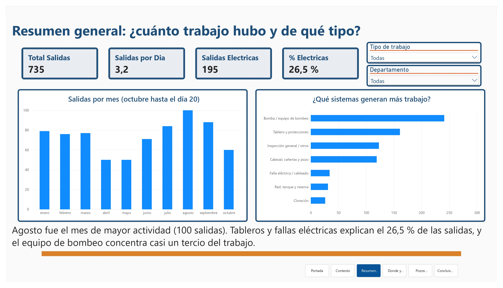
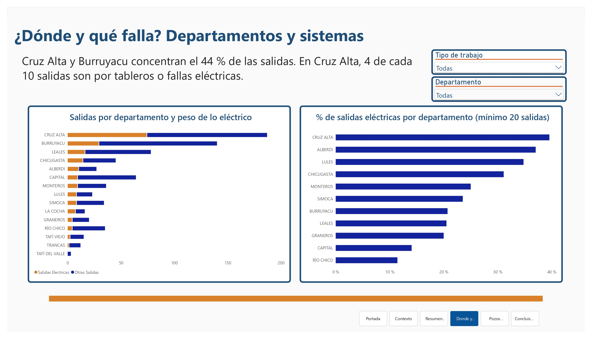
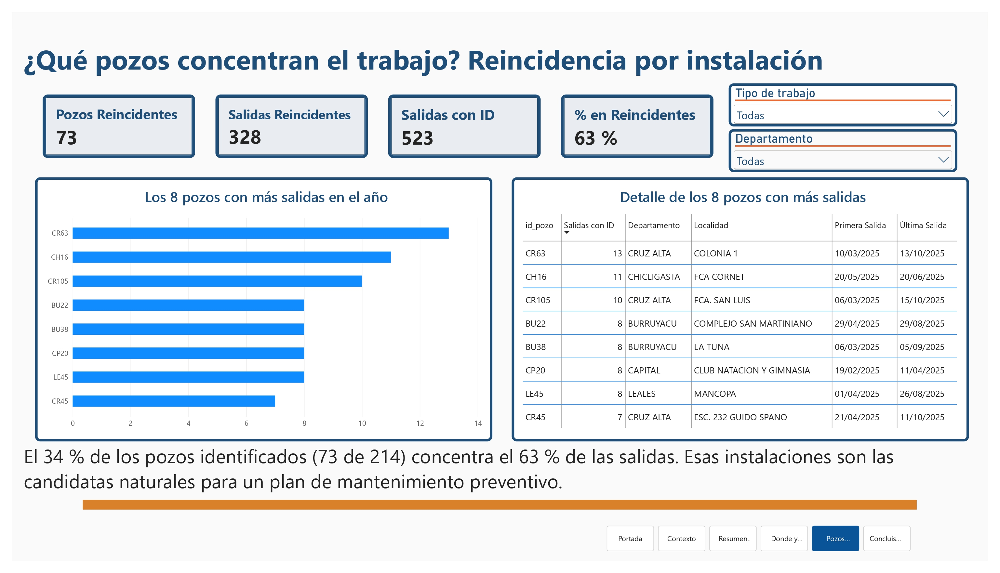
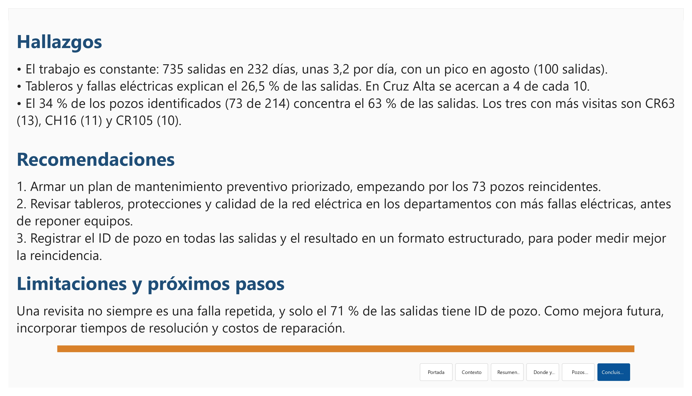
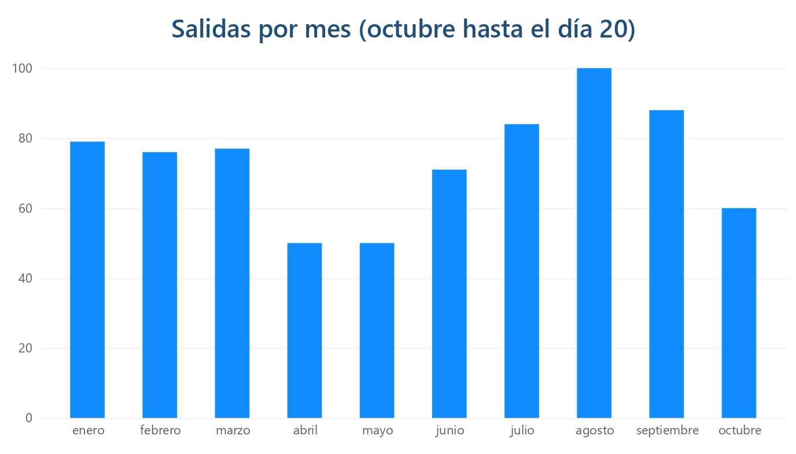
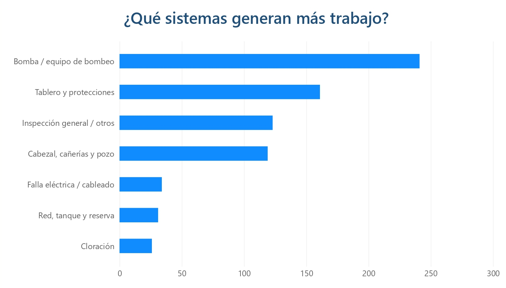
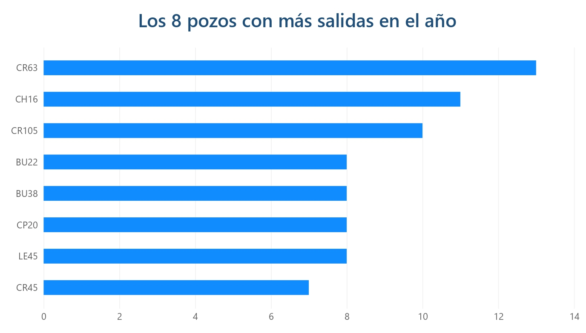

# Análisis del parte diario de mantenimiento de pozos de agua potable (Tucumán, 2025)

Análisis de **735 salidas de cuadrillas técnicas** (2 de enero – 20 de octubre de 2025) a pozos de extracción de agua subterránea en 15 departamentos de Tucumán. Los datos provienen del parte diario de trabajos de un organismo provincial de agua potable, información que se publica oficialmente. Todo el material está **anonimizado**: los operarios figuran como Agente 1, 2, 3…, y se eliminaron teléfonos y datos de vehículos o gastos.

**Objetivo:** entender dónde se concentra el trabajo de mantenimiento correctivo, qué fallas se repiten y qué instalaciones conviene atender de forma preventiva.

**Herramientas:** Python (Pandas, Matplotlib) para limpieza y categorización, SQL (CTE y funciones de ventana, probadas en SQLite) y Power BI (DAX y dashboard de 6 páginas).

## Dashboard en Power BI

Informe de 6 páginas: portada, contexto, resumen general, dónde y qué falla, pozos reincidentes y conclusiones. Archivo: `dashboard/dashboard.pbix` (versión en PDF: `dashboard/dashboard.pdf`).

| | |
|---|---|
|  |  |
|  |  |

Medidas DAX principales: `Total Salidas`, `Salidas Eléctricas`, `% Eléctricas`, `Salidas por Día`, `Pozos Reincidentes`, `Salidas en Reincidentes` y `% en Reincidentes`. Los resultados del dashboard coinciden con los de Python y SQL.

## Hallazgos principales

| # | Hallazgo | Dato |
|---|---|---|
| 1 | Volumen de trabajo | 735 salidas en 232 días de trabajo (≈ 3,2 por día), en 250 localidades |
| 2 | Más diagnóstico que reparación | 60 % de las salidas fueron inspecciones/diagnóstico, 25 % recambios o instalaciones y 12 % reparaciones |
| 3 | El equipo de bombeo es lo que más pesa | 33 % de las salidas (241); tablero y protecciones, 22 % (161) |
| 4 | Peso de lo eléctrico | Tablero y fallas eléctricas suman el 26,5 % del total (195 salidas); en Cruz Alta llegan al 40 % (74 de 187) |
| 5 | Pozos reincidentes | 73 de los 214 pozos identificados tuvieron 3 o más salidas y concentran el 63 % de las salidas con ID (328 de 523) |
| 6 | Revisitas rápidas | 74 % de las revisitas al mismo pozo ocurrieron dentro de los 30 días (230 de 309) |
| 7 | Estacionalidad | Pico en agosto (100 salidas) y valle en abril–mayo (50 cada mes) |
| 8 | Resultado de las salidas | En las 160 salidas cuyo resultado se pudo clasificar, el 39 % terminó en bomba quemada o daño eléctrico |
| 9 | Dependencia de la compra | 29 salidas quedaron esperando que la comuna adquiriera el repuesto |






## Qué sugieren los datos

- Si el 60 % de las salidas son diagnósticos, un **relevamiento previo y una checklist de tablero y mediciones eléctricas** podrían evitar parte de esas salidas y mejorar la preparación del equipo antes de cada visita.
- Los pozos con 3 o más salidas son candidatos naturales para un **plan de mantenimiento preventivo priorizado**, empezando por tablero y protecciones.
- Cruz Alta, con fallas eléctricas en torno al 40 %, es un buen lugar para revisar **calidad de red y protecciones** antes de reponer bombas.

## Control de calidad de los datos

- La clasificación de tareas y sistemas se hizo con reglas de texto sobre unas 450 formas distintas de escribir la tarea, y después se **revisaron y corrigieron a mano 9 casos** mal clasificados (`data/correcciones_manuales.csv`).
- Se excluyó 1 salida que no era una tarea de pozos (traslado de repuestos de un vehículo), por eso son 735 y no 736.
- Los resultados del dashboard se validaron contra Python y SQL: los totales, los porcentajes y los pozos reincidentes coinciden.

## Limitaciones (importante leerlas)

- La clasificación sigue siendo una aproximación, no una auditoría de cada registro.
- Solo el 71 % de las salidas tiene ID de pozo, por eso los análisis de reincidencia usan ese subconjunto.
- Una revisita no siempre es una falla repetida: puede ser una visita programada (diagnóstico y luego recambio).
- Un mismo pozo puede figurar con distinta localidad o departamento según el registro, por lo que algunas tablas muestran el primero que aparece.
- El resultado de la salida es texto libre; solo 160 de las 735 salidas pudieron clasificarse automáticamente, así que el hallazgo 8 no es representativo del total.
- Octubre está incompleto (datos hasta el día 20).
- Los datos reflejan registros administrativos, no mediciones técnicas de campo.

## Estructura del proyecto

```
limpieza.py                     # limpieza, categorización, correcciones y anonimización
graficos.py                     # gráficos del análisis
consultas.sql                   # 6 consultas SQL (CTE, LAG, SUM OVER, CASE)
data/salidas_2025_limpio.csv    # datos limpios y anonimizados
data/correcciones_manuales.csv  # reclasificaciones revisadas a mano
graficos/*.png
dashboard/                      # archivo .pbix, PDF y capturas del informe
```

Para reproducir: `python limpieza.py <excel_original>` y luego `python graficos.py`. El Excel original no se incluye en el repositorio.
